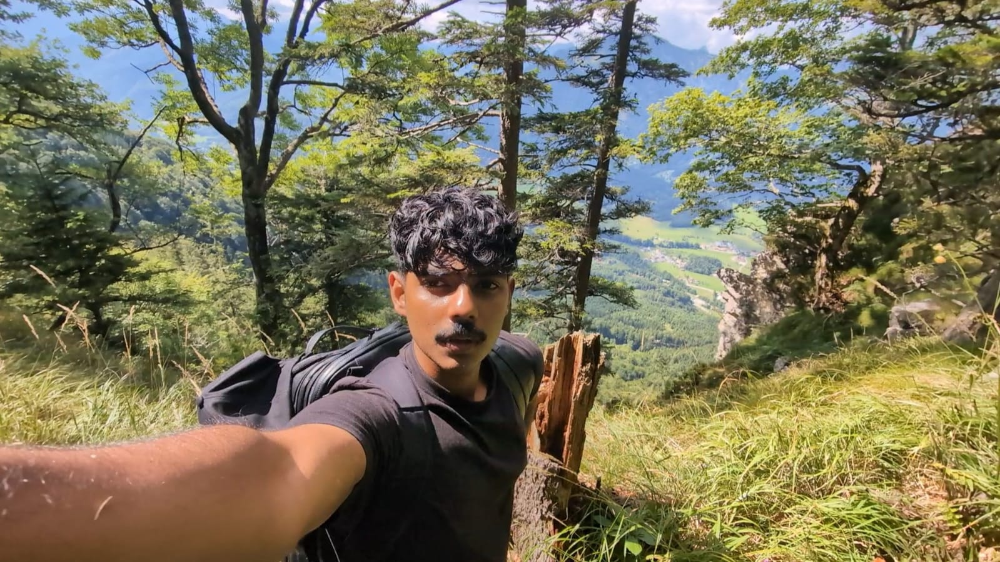

---
{
  "title": "About",
  "portrait": "images/about/profile.jpg"
}
---

My main interests lie in psychology, neuroscience, psychiatry, and philosophy. I'm fascinated by the human mind, how people think and behave, and how much we still don't understand about the brain. I'm particularly interested in computational psychiatry and the possibility of using mathematical and computational models to investigate questions about cognition, learning, and behavior. I want to understand how these models connect to what we know about the brain, where they offer useful insights, and where their explanations fall short.

Philosophy is another important part of this interest. I'm drawn to questions about consciousness, human experience, suffering, and the limits of scientific knowledge. I enjoy exploring the space between what we can observe, what we can explain, and what remains uncertain. I'm still developing my own understanding of these subjects, and I'd rather ask difficult questions than settle for explanations that sound convincing but leave the underlying problem untouched.

I study Artificial Intelligence at FH Hagenberg, and it gives me a technical foundation to explore some of these interests. I work on AI projects, experiment with language models, and implement neural networks and other computational methods. I'm interested in the technical side, but primarily in what these tools might allow me to investigate beyond AI itself.

Most of my skills are self-taught. I read, build things, explore ideas, and document what I learn along the way. This notebook is where I bring those interests together: my projects, my research interests, my reading, and the questions I'm still trying to make sense of.

Muhsin Ahamed   
+4369020067065  
Softwarepark 23  
4232  
Hagenberg  
Austria  

[GitHub](https://github.com/Muhsiinn) · [Email](mailto:muhsinahmdtk@gmail.com)
