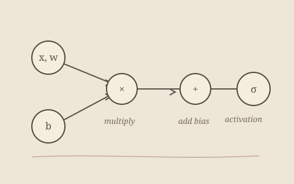

---
{
  "title": "Neural Network Library",
  "status": "IN PROGRESS",
  "technologies": [
    "Fortran",
    "Neural networks"
  ],
  "description": "A neural network library written in Fortran, currently a work in progress. This entry will grow alongside the implementation; architecture, supported operations, and experiments remain to be documented.",
  "links": {}
}
---

