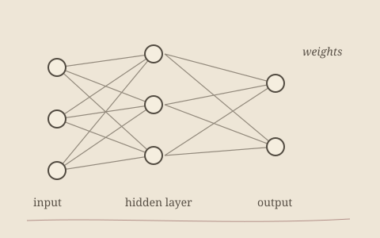

---
{
  "title": "Malaria Cell Classifier",
  "status": "COMPLETED",
  "technologies": [
    "Python",
    "TensorFlow / Keras",
    "CNN",
    "NumPy",
    "Matplotlib"
  ],
  "description": "An early deep learning project classifying blood cell images as infected or uninfected with malaria using a CNN. Prepared the data, trained with binary crossentropy and Adam, and evaluated with accuracy/loss plots and a confusion matrix.",
  "links": {}
}
---

This was one of my early deep learning projects. The goal was to classify blood cell images as infected or uninfected with malaria using a Convolutional Neural Network (CNN).

Prepared the dataset by resizing and normalizing images.

Split the data into training and testing sets.

Built a CNN with convolutional, pooling, dropout, and dense layers.

Trained the model using binary crossentropy loss and the Adam optimizer.

Evaluated performance with accuracy/loss plots and a confusion matrix.

Tested the model on sample images to check predictions.

Basics of how CNNs process images through filters and pooling.

Understood backpropagation better by seeing how training updates weights.

Learned the importance of using validation data and dropout to reduce overfitting.

Gained experience in monitoring training with plots and metrics, not just final accuracy.

 <ins> Room for improvement </ins>

There is room for improvement in this project. Since working on later projects like SimCLR, I have learned additional techniques and evaluation methods. In the future, I may revisit this project to apply data augmentation, richer evaluation metrics, and better regularization strategies.
