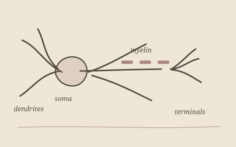

---
{
  "title": "Computational Models of Neurons and the Brain",
  "status": "IN PROGRESS",
  "technologies": [
    "Computational modeling",
    "Neuroscience"
  ],
  "description": "library for simulating neurons and brain",
  "links": {}
}
---

