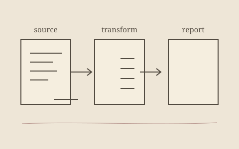

---
{
  "title": "Austrian Food Price Analysis",
  "status": "COMPLETED",
  "technologies": [
    "Python",
    "NumPy",
    "Pandas",
    "Matplotlib"
  ],
  "description": "Compared the Producer Price Index with the Consumer Price Index for Austrian food to see how producers and consumers are affected. Cleaned and aligned the CSVs, then plotted the widening gap over time.",
  "links": {
    "github": "https://github.com/Muhsiinn/Austrian-food-price-analysis/tree/main"
  }
}
---

I wanted to understand how food prices move in Austria, so I compared the Producer Price Index (PPI) with the Consumer Price Index (CPI). I used Python with NumPy and Pandas to clean the CSVs, align dates, and calculate a simple gap = normalized(CPI) − normalized(PPI).

I also plotted the trends to see when the gap widens or closes (it clearly grew after 2010).
Nothing fancy—just solid data wrangling and clear visuals.

Loaded/cleaned PPI & CPI data (handled non-numeric rows, missing values, misaligned periods).

Normalized series to compare shapes.

Aggregated monthly → yearly (also kept monthly for detail).

Plotted PPI vs CPI and the gap over time.

Wrote up key takeaways + limitations in the README.

<ins> outcomes </ins>

Practical cleanup with Pandas (types, filtering, grouping, resampling).

Why normalization helps comparisons but can hide scale.

How a small “gap” metric can tell an easy story.
